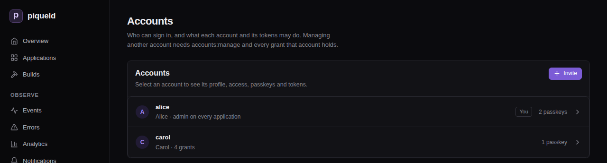
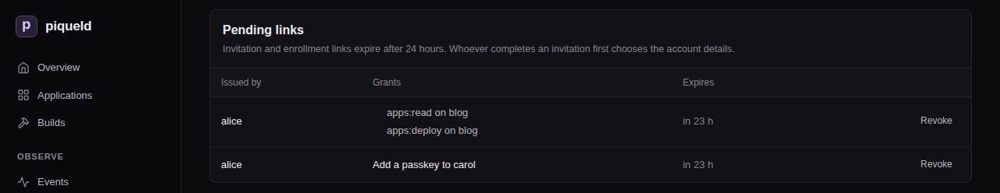
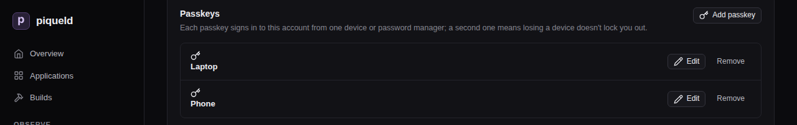
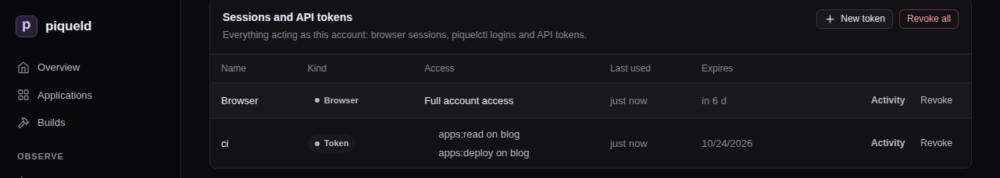

# Managing accounts

Invite people to piqueld, help them add passkeys, and remove their access when
they leave. You do this on the dashboard's **Accounts** page or with
`piquelctl account`.

## Before you start

- You have [an account](../getting-started/first-account.md). Everyone can
  change their own account. Changing someone else's needs `accounts:manage`
  and every grant their account holds; see
  [who may manage accounts](permissions.md#who-may-manage-accounts).
- The `piquelctl` commands on this page run on your machine, signed in as your
  account, as when you
  [signed it in](../getting-started/first-account.md#sign-piquelctl-in).
  [`piquelctl account`](../reference/cli-commands.md#piquelctl-account) lists
  their options.

## The Accounts page

Open **Accounts** in the dashboard's sidebar. It lists each account with its
display name, its access in a few words, and how many passkeys it has. Select
an account to open its page: the **Profile** tab holds its **Profile** and
its **Access**, and the **Access** tab its **Passkeys** and its **Sessions and
API tokens**.



Without `accounts:manage`, the page only shows your own account. With it, the
page lists every account, the invitation and enrollment links waiting to be
used under **Pending links**, and the browsers signed in as the host operator
under **Host operator sessions**.

`piquelctl account list` prints the same accounts and their grants:

```console
$ piquelctl account list
alice (01a16b4b-ef93-7971-b6f6-e8359d3c4d52)
  admin on every application
bob (01a16b4c-84dc-70d1-98eb-0ddfde57971b)
  apps:read on blog, shop
  apps:write on blog, shop
…
```

## Invite someone

An invitation is a link that creates one account. You choose what the account
may do: there's no default access. The person who opens the link chooses its
username and registers its passkey.

The link isn't tied to a person or an email address: whoever completes it
first gets the account and its access. Send it only to the person it's for,
over a private channel you trust. If anyone else may have seen it,
[revoke it](#revoke-an-invitation).

1. On the **Accounts** page, select **Invite**.
2. To limit the access to some applications, clear **Application permissions
   apply to every application, including future ones**, and select them.
3. Choose a **Preset**, or select permissions one by one.
   [Permissions](permissions.md) says what each one allows.
4. Select **Create link**.
5. At the top of the page, select **Copy** next to the new link, then
   **Done**.
6. Send the link to the person it's for.

With `piquelctl`:

```console
piquelctl account invite --preset developer --app blog --app shop
```

It prints the link, such as
`https://piqueld.<tailnet>.ts.net/dashboard/auth#invite=…`. `--preset` and
`--permission` choose the access, and `--app` limits it to applications, by
name or ID. [Give an account access](permissions.md#give-an-account-access)
describes these options. You can only hand out access you hold yourself.

When the person opens the link, the **Create your account** page asks for a
**Username**, an optional display name, and a **Passkey name**. They select
**Create account with a passkey**, save the passkey, and the dashboard opens,
signed in.

The link works once, within 24 hours. Opening it doesn't use it up, so
someone who closes the page before finishing can open the original link
again. The dashboard removes the link from the browser's address bar and
history as soon as it reads it.

## Revoke an invitation

Links waiting to be used are listed under **Pending links**, at the bottom of
the **Accounts** page, with who issued them, what they grant, and when they
expire. Enrollment links show **Add a passkey to** and the account's name.



Select **Revoke** to cancel a link before it's used. Deleting the account that
issued a link also revokes it.

A pending link hasn't issued anything yet, so revoking it cancels only the
link, and there's no **Also revoke what it issued** option. Once used, the
link no longer appears here: to take back the passkey and session it gave,
revoke [the credential that created it](#what-revoking-also-revokes).

With `piquelctl`, list the links to find the one to revoke, then revoke it by
its ID:

```console
$ piquelctl account invitation list
01a16b52-3f0e-7c41-9d2a-6b8e0f4c7d15 invitation by alice (expires at 2026-10-29 08:20:00Z)
  apps:read on blog
  apps:deploy on blog
01a16b53-7a21-7e93-8c4f-2d9b1e6a0c38 enrollment for carol by alice (expires at 2026-10-29 08:30:00Z)
$ piquelctl account invitation revoke 01a16b52-3f0e-7c41-9d2a-6b8e0f4c7d15
```

## Add a passkey

Each passkey belongs to one account, and only that account adds one: from a
browser where it's signed in, or through an enrollment link.

### To your own account

1. Open your account from the **Accounts** page, then its **Access** tab.
2. Under **Passkeys**, select **Add passkey**, and name it after the device it
   lives on, such as `Phone`.
3. Select **Add passkey** in the dialog, and save the passkey when your
   browser asks. If you signed in more than 2 minutes ago, the dashboard
   first asks you to
   [confirm with your passkey](#confirm-with-your-passkey).



To add one on a device with no browser signed in, print an enrollment link for
your own account with `piquelctl`, signed in with your account's full access:

```console
piquelctl account enroll alice
```

Open the link on that device yourself, and don't share it: it signs in
whoever uses it.

A second passkey, on another device or in a password manager, means losing one
device doesn't lock you out. If you've already lost them all, see
[someone lost their passkey](recovery.md#someone-lost-their-passkey).

### To someone else's account

When someone has lost their passkeys, or wants to sign in on a device that
can't share them, send them an enrollment link.

Whoever uses the link registers a passkey on the account and signs in as it,
with all its access. Before you create one, check that the request comes
from the account's owner, such as in person or over a channel you already
know is theirs. Send the link over a private channel you trust. If anyone else
may have seen it, [revoke it](#revoke-an-invitation).

1. Open their account from the **Accounts** page, then its **Access** tab.
2. Under **Passkeys**, select **Create enrollment link**.
3. At the top of the page, select **Copy** next to the new link, then
   **Done**.
4. Send them the link.

Or create it with `piquelctl`:

```console
piquelctl account enroll bob
```

When they open the link, the **Add a passkey** page asks for a **Passkey
name**. They select **Register passkey**, save the passkey, and the dashboard
opens, signed in as their account.

The link works once, within 24 hours. Creating another link doesn't cancel the
first; revoke the ones you no longer need under **Pending links**.

## Rename or remove a passkey

Under **Passkeys**, on the account's **Access** tab, select **Edit** next to
the passkey, change its **Passkey name** and select **Save**.

Removing a passkey can't be undone. To remove one, select **Remove** next to
it, then **Remove** in the dialog that asks you to confirm.

With `piquelctl`, list the passkeys to find their IDs, then rename or remove
one:

```console
$ piquelctl account passkey list bob
01a16b4f-2c8d-7b16-a5e3-9f0d4c7b2e61 Laptop (bob)
$ piquelctl account passkey rename 01a16b4f-2c8d-7b16-a5e3-9f0d4c7b2e61 "Work laptop"
$ piquelctl account passkey remove 01a16b4f-2c8d-7b16-a5e3-9f0d4c7b2e61
```

`account passkey remove` asks you to confirm first.

Removing a passkey stops it from signing in. It also ends the browser sessions
it signed in, and [everything issued through them](#what-revoking-also-revokes),
so a lost or stolen passkey loses all the access it opened. The account's
other passkeys were usually added through its first one, so removing that one
may remove them too. To end only the passkey, clear
**Also revoke what it issued** in the dialog, or add `--no-cascade`.

## Confirm with your passkey

Some actions need a passkey sign-in within the last 2 minutes. They protect
the account if someone gets hold of a signed-in browser or CLI login:

- adding a passkey;
- creating an API token, an invitation or an enrollment link;
- giving an account `admin`, `accounts:manage`, `system:operate` or
  `settings:manage`, which it didn't hold (removing access never asks);
- approving a [CLI login](cli-and-tokens.md#sign-piquelctl-in);
- [recovering a lost secret key](recovery.md#a-lost-secret-key).

When your sign-in is older, the dashboard shows **Confirm with your passkey**
over the form. Select **Confirm with passkey** and use your passkey; the
action then continues by itself. **Cancel** stops the action and keeps what
you entered, so you can try again.

`piquelctl` asks you to confirm in a browser instead: see
[confirm a sensitive action](cli-and-tokens.md#confirm-a-sensitive-action).

A session opened by a setup, invitation, enrollment or recovery link counts as
older, until you confirm once. Using piqueld doesn't renew the 2 minutes: only
a passkey does.

API tokens can never confirm, so these actions refuse them with
`reauthentication_required`. Use a signed-in account instead. The
[host operator](recovery.md#the-host-operator) is never asked.

## Edit a profile

Under **Profile**, on the account's page, change the **Username** or the
**Display name**, then select **Save profile**.

- A username has 1 to 64 ASCII letters, digits, dots, dashes or underscores.
  It is unique regardless of case: `Alice` and `alice` are the same name.
- A display name is optional, up to 200 bytes.

With `piquelctl`, give the new `--username`, `--display-name`, or both:

```console
piquelctl account update bob --username robert --display-name "Robert"
```

If you saved a `piquelctl` login for the account, its name changes with it, so
`--account robert` selects it.

Renaming an account doesn't change its ID, which the
[audit trail](../operations/audit.md) and saved CLI logins
use. To change someone's access instead, see
[give an account access](permissions.md#give-an-account-access).

## Revoke sessions and tokens

**Sessions and API tokens**, on the account's **Access** tab, lists everything
that acts as the account: browser sessions (**Browser**), `piquelctl` logins
(**Cli**), and [API tokens](cli-and-tokens.md#create-an-api-token)
(**Token**). Each row shows what it may do, when it was last used, and when it
expires.



- **Revoke** asks you to confirm, then ends one at once, with
  [what it issued](#what-revoking-also-revokes).
- **Revoke all** asks you to confirm, then ends all of them, with what they
  issued, including the session you're using if it's your own account. That
  also removes the passkeys the account added while signed in, usually all
  but its first; clear **Also revoke what it issued** to keep them.
- **Activity** opens its requests in the audit trail.

With `piquelctl`, `token list` lists your own sessions and tokens, and
`token revoke <id>` revokes one; see
[revoke a token](cli-and-tokens.md#revoke-a-token). Add `--user` for someone
else's account, and `--all` to revoke them all:

```console
piquelctl token list --user bob
piquelctl token revoke --all --user bob
```

Without `--user`, `token revoke --all` signs your own account out everywhere,
including the `piquelctl` login running it. It also revokes what they
issued, including what the account's sessions and logins issued before they
logged out, expired or were pruned, and so removes the passkeys the account
added while signed in: add `--no-cascade` to keep them. An API token or
[limited login](cli-and-tokens.md#ask-for-less-access) can't do this for its
own account.

### What revoking also revokes

Revoking a session, `piquelctl` login or API token also revokes everything
issued through it, in any account:

- the API tokens and `piquelctl` logins it created or approved;
- the invitation and enrollment links it created;
- the passkeys added with it, or registered through those links;
- the browser sessions those passkeys signed in;
- everything those issued in turn.

It reaches them even when credentials in between have since logged out or
expired. It never deletes an account: someone who loses a passkey this way
keeps the account and its access, and can get an
[enrollment link](#to-someone-elses-account) to add a new one.

Removing a passkey and deleting an account revoke what was issued through them
the same way. To revoke only what you selected, clear
**Also revoke what it issued** in the confirmation dialog. With `piquelctl`,
add `--no-cascade`:

```console
piquelctl token revoke --no-cascade 01a16b4e-6995-79b2-bfb1-0f72630a4d96
```

Logging out and expiring never revoke what a credential issued. Credentials,
links and passkeys created before piqueld recorded who issued them are only
revoked on their own.

## Delete an account

Deleting an account also deletes its passkeys, sessions and tokens, and the
links it issued. It also revokes
[everything they issued](#what-revoking-also-revokes) in other accounts:
passkeys registered through its invitations, for example. It can't be undone.
Its requests stay in the audit trail.

1. Open the account from the **Accounts** page and select **Delete account**,
   at the top of its page.
2. Confirm in the dialog that asks whether to delete the account and all its
   passkeys, sessions, and tokens. To leave what it issued elsewhere valid,
   clear **Also revoke what it issued** first.

You can delete your own account. With `piquelctl`, which asks you to confirm
first:

```console
piquelctl account delete bob
```

Add `--no-cascade` to leave what it issued elsewhere valid.

## Troubleshooting

- **The change is refused with `account_lockout`.** At least one account must
  keep `admin` on every application and a passkey, so that someone can always
  sign in and manage piqueld. piqueld refuses to remove the last such
  account's access, its last passkey, or the account itself. Make another
  account that has a passkey an administrator first. When a revocation is
  refused because of [what it also revokes](#what-revoking-also-revokes),
  clear **Also revoke what it issued**, or add `--no-cascade`, and revoke
  what you mean to one at a time.
- **The change is refused with `permission_exceeded`.** The account holds
  access you don't, or you're handing out access you don't hold. Ask someone
  who holds it.
- **A link answers "API returned 400 Bad Request: authentication_invalid
  (this link is invalid, expired, or already used)".** It was already used,
  has expired, or was revoked. Ask for a new link.
- **The same refusal comes after the browser saved the passkey.** The link
  expired, was revoked or was used in the meantime, or its issuer can't
  create it any more: they lost `accounts:manage` or the access it grants, or,
  for an enrollment link, the right to change that account. Delete the saved
  passkey from the device, and ask for a new link. A link refused because of
  its issuer stays under **Pending links** until it expires.
- **Registration fails with `account_conflict`.** Another account has that
  username, regardless of case. Register again with another name. If someone
  took the name while you were creating the passkey, the browser has saved
  it already: delete it from the device first.
- **Creating a link answers "the host operator is not an account".** Sign in
  with an account to create invitations and enrollment links.
