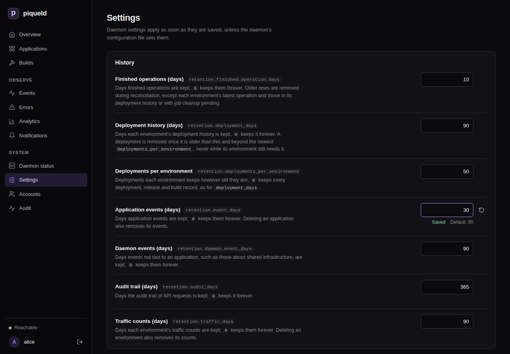

# Changing daemon settings

Daemon settings are your installation's policy: how long history and the
audit trail are kept, how many previews may exist, how often piqueld checks
for drift. Change them from the dashboard or `piquelctl`, and they apply at
once, without restarting the daemon.

The daemon's other settings describe its host, such as its listeners, its
Docker socket and its DNS provider accounts. Those only change in its
[configuration file](../reference/configuration.md), with a restart. The
configuration file doesn't set daemon settings.

## Before you start

- Reading settings needs the `system:read` permission.
- Changing them needs `settings:manage`. It can shorten how long the audit
  trail is kept, so granting it needs a recent passkey sign-in, like
  `accounts:manage`; see [permissions](../accounts/permissions.md).

## See the settings

In the dashboard, open **Settings** under System. Each section of daemon
settings, such as **History** or **Previews**, lists its settings, each with
what it does and its value in a field. A setting someone changed shows its
default under the field, and a button beside it to reset it.



The host's settings follow, read-only.

On your machine, `piquelctl settings` lists the same, with where each value
comes from:

- **default**: nobody changed it.
- **changed**: someone changed it from the dashboard, `piquelctl` or the API.

```console
piquelctl settings
```

```text
History:
  retention.finished_operation_days: 10 (default)
  retention.event_days: 30 (changed)
  retention.audit_days: 365 (default)
```

Show one setting with its range, default and what it does:

```console
piquelctl settings get retention.event_days
```

## Change a setting

In the dashboard, type the new value in the setting's field, then press
Enter or select **Save** under the field. Until then the field says
**Not saved**, and leaving it saves nothing: Escape, or **Cancel**, brings
the setting's value back. A switch or a choice saves as soon as you change
it. A setting with no limit, such as **Longest token lifetime (days)**,
takes an empty field.

With `piquelctl`:

```console
piquelctl settings set retention.event_days 30
```

Settings that allow no limit take `none`, switches `true` or `false`, and
choices one of their values:

```console
piquelctl settings set auth.max_token_days none
piquelctl settings set ingress.traffic false
piquelctl settings set build.unavailable local
```

The new value applies at once. Pruning uses new retention periods on its next
pass, the reconciliation scan and image cleanup move to their new interval,
new previews, tokens and uploads are checked against the new limits, the
gateway starts or stops counting traffic, and the next build follows
`build.unavailable`.
Lowering a limit never removes what already exists: existing previews keep
running, and existing tokens keep their lifetime.

Keeping less history does remove it. Lowering a setting under **History**,
or **Output kept (days)**, deletes what the new value no longer keeps the
next time piqueld prunes, and nothing brings it back. The dashboard asks you
to confirm such a change, and a reset that does the same. `piquelctl settings
set` doesn't ask.

Lowering how many deployments keep their images, under **Images**, removes
images too, at the next cleanup: from this host, and with a build machine,
from its registry for good. A deployment whose images are gone can't be
restored from this host, or, once the registry has deleted them, at all.
Lowering `images.keep_deployments` also lets history keep fewer
deployments. The dashboard asks you to confirm these changes too.

Every change is recorded in the [audit trail](audit.md), with the old and the
new value.

[Daemon settings](../reference/daemon-settings.md) lists every setting, with
its range and default.

Some settings apply only with what the installation has:
`build.unavailable` needs a [build machine](../applications/build-machine.md).
Without one, the dashboard shows its value without a field, `piquelctl
settings` says what it needs, and changing it fails with
`setting_unavailable`. A value changed while the build machine was there can
still be reset.

## Reset a setting

A changed setting goes back to its default with the reset button beside its
field in the dashboard, which then says what the value was, or:

```console
piquelctl settings reset retention.event_days
```

## Upgrade from a configuration file that sets them

Older versions read daemon settings, such as `[retention]` or
`auth.max_token_days`, from the
[configuration file](../reference/configuration.md). This version refuses to
start with a file that still sets one, and names it:

```text
[retention] holds daemon settings, which the configuration file no longer sets: remove the table, and change them with `piquelctl settings set` or the dashboard's Settings page
```

The daemon doesn't carry the file's values over. Until you set them again,
each setting has its default, and **the first start prunes history with the
defaults**: if the file kept more than they do, such as `audit_days = 730`
or `event_days = 0` (forever), the daemon deletes what only the file's value
kept, at once, for good. The same goes for images an `[images]` value kept.

1. Note the values the file sets that differ from their defaults, which
   [daemon settings](../reference/daemon-settings.md) lists.
2. If any of them keeps more history or images than its default, back up the
   daemon's state first to keep a copy of what it will delete; see
   [backups](backups.md). The daemon can't take it back: restoring the backup
   would prune it again on the next start.
3. Remove them from the file, then start the daemon.
4. Set each value you noted again, at once:

   ```console
   piquelctl settings set retention.audit_days 730
   ```

On NixOS, a generation that still sets one under `services.piqueld.settings`
fails to build instead, saying which; see the
[NixOS module](../reference/nixos.md). The same steps apply.

## Check that it works

`piquelctl settings get <key>` shows the value in effect and its source. The
[audit trail](audit.md) shows who changed it, and when:

```console
piquelctl audit
```

## Troubleshooting

- **The daemon won't start: "… is a daemon setting" or "[…] holds daemon
  settings".** The configuration file still sets a daemon setting. See
  [upgrade from a configuration file that sets them](#upgrade-from-a-configuration-file-that-sets-them).
- **`setting_invalid`.** The value is out of the setting's range. The error,
  and `piquelctl settings get <key>`, say which values it takes.
- **`setting_unavailable`.** The installation lacks what the setting needs,
  such as a build machine for `build.unavailable`.
- **`setting_unknown`.** No setting has this key. `piquelctl settings` lists
  them.
- **`permission_denied`.** Changing a setting needs `settings:manage`.
